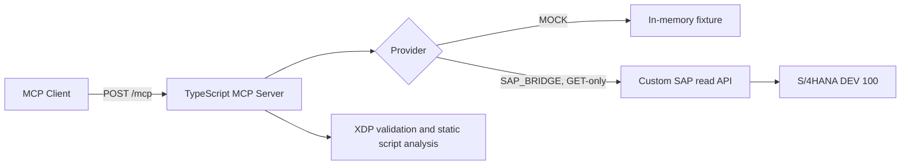

# SAP Adobe Form MCP Server (read only)

TypeScript MCP server for querying customer-developed SAP Adobe SFP forms, using **Streamable HTTP**, the official **MCP TypeScript SDK v2**, mock fixtures, a configurable SAP destination, and XDP script analysis.

> **Integration boundary:** This repository contains a working MCP application design and local MOCK provider. `SAP_BRIDGE` uses the **custom read-only SAP API contract** documented in `docs/SAP_BRIDGE_CONTRACT.md`. The SAP API is *not* installed by this project. It is **not** an SAP standard API. No live connection to the supplied DEV S/4HANA system has been established or verified.

## Architecture



## Requirement coverage

| Phase 4 task | Implementation | Status |
|---|---|---|
| Node.js LTS / TypeScript / MCP SDK | Node >=22, TS, MCP SDK v2 | Source created; install/build required |
| Streamable HTTP endpoint | Authenticated `/mcp` (stateless, modern+legacy client compatibility) | Source created |
| `list_custom_forms` | Regex-validated name pattern and bounded limit | MOCK implemented; SAP bridge contract pending |
| `get_form_metadata` | Form metadata | MOCK implemented; SAP bridge contract pending |
| `get_form_interface` | Interface type, parameters | MOCK implemented; SAP bridge contract pending |
| `get_form_context` | Real SFP context hierarchy from upstream | MOCK implemented; SAP bridge contract pending |
| `get_form_layout` | Base64 decode, XML/XDP validation, optional XML return | MOCK implemented; live XDP read must be validated |
| `analyze_form_scripts` | JavaScript/FormCalc, lifecycle event inventory, static findings | MOCK implemented; no script execution |
| SAP Destination / Client | `config/destinations.json`, credentials in env, per-tool destination | Implemented as configuration; live auth not tested |

## Prerequisites

- Node.js 22+ (LTS recommended), npm, network access to npm registry
- For `SAP_BRIDGE` mode: reachability to SAP DEV and a separately implemented + activated custom read-only SAP service
- For remote hosting: hardened HTTPS reverse proxy and host OAuth/token integration (see security notes)

## Start in MOCK mode (Windows PowerShell)

```powershell
# Extract ZIP first, then open PowerShell in the sap-adobe-form-mcp folder
Copy-Item .env.example .env
# Edit .env and set MCP_AUTH_TOKEN to a unique, random 24+ character value.
# Keep PROVIDER=MOCK
npm install
npm run check
npm run build
npm test
npm start
```

When running, the app listens at `http://127.0.0.1:3000/mcp`. `/health` can be checked in a local browser and returns only `{ "status": "ok", "provider": "MOCK" }`.

In a **second** terminal run:

```powershell
npm run smoke
```

Smoke test connects to MCP, discovers tools, and calls `list_custom_forms` for two synthetic Z forms.

### Quick manual MCP request (PowerShell)

```powershell
$token = (Get-Content .env | Where-Object { $_ -match '^MCP_AUTH_TOKEN=' }) -replace '^MCP_AUTH_TOKEN=', ''
$headers = @{ Authorization = "Bearer $token"; Accept = 'application/json, text/event-stream' }
$body = @{ jsonrpc='2.0'; id=1; method='initialize'; params=@{ protocolVersion='2025-11-25'; capabilities=@{}; clientInfo=@{ name='test'; version='0.1' } } } | ConvertTo-Json -Depth 5
Invoke-WebRequest -Uri http://127.0.0.1:3000/mcp -Method Post -Headers $headers -ContentType 'application/json' -Body $body
```

Use `npm run smoke` for a more complete MCP handshake and tool invocation test.

## Switch to SAP DEV (requires SAP bridge activation)

1. Keep the existing `config/destinations.json` entry for `DEV100` (base URL `https://s4hvm.ides01.com:44300`, client `100`). It contains *no passwords*.
2. Implement & activate the custom SAP read-only GET endpoints from `docs/SAP_BRIDGE_CONTRACT.md` and verify through SAP Gateway/ICF with a read-only user.
3. Set `.env` `PROVIDER=SAP_BRIDGE`, `SAP_DEV100_USER=<technical_user>`, `SAP_DEV100_PASSWORD=<secret>` (or `SAP_DEV100_TOKEN` when supported).
4. If your SAP certificate chains to a private CA, trust it with `NODE_EXTRA_CA_CERTS`; never disable TLS validation.
5. Restart the server, run `npm run smoke`, and compare the result with SFP in client 100.

The SAP service URL is constructed **only** from destination configuration, e.g. GET `https://s4hvm.ides01.com:44300/sap/bc/zform_read/v1/forms?sap-client=100&pattern=Z*&limit=50`.

## MCP tools

There are **six** tools, all read-only: `list_custom_forms`, `get_form_metadata`, `get_form_interface`, `get_form_context`, `get_form_layout`, `analyze_form_scripts`. Tool arguments accept `destination` (optional, defaults to DEV100). Form names use exact SFP Z/Y or customer namespaced naming and are case-insensitive with mock data.

Examples of arguments:

```json
{ "pattern": "Z*", "limit": 20, "destination": "DEV100" }
```

```json
{ "name": "ZDEMO_INVOICE", "destination": "DEV100" }
```

```json
{ "name": "ZDEMO_INVOICE", "includeSnippets": true }
```

- `get_form_layout` defaults to returning only XDP structure metadata. Set `includeXml=true` to return the complete XDP, potentially containing confidential design/code.
- `analyze_form_scripts` performs static analysis, and never executes or renders the JavaScript/FormCalc. It reports probable lifecycle concerns; these are **heuristics**, not a full runtime verification.
- Mock fixture names start with `ZDEMO_`; nothing in MOCK mode is retrieved from your SAP instance.

## Security and production notes

- MCP accepts a **static Bearer token** only for local development; `/mcp` returns HTTP 401 without it. Keep the server bound to loopback. Config rejects `0.0.0.0` binds by design.
- The local Bearer approach is **not production-grade OAuth**, and does not automatically satisfy the authentication model needed by remote ChatGPT connectors. A remote deployment needs HTTPS, official OAuth/identity controls for users, routing and authorization, plus security review.
- The transport uses the SDK v2's stateless MCP HTTP handler, supporting modern protocol revision and legacy stateless requests.
- Don't expose SAP passwords, complete XDP documents, or script snippets in logs or prompts without assessing confidentiality.
- Input validates form names, destination ids, list pattern and size. Remote SAP access uses HTTPS, GET-only, timeout, JSON schema validation, no redirects and bounded response bodies.
- In the ABAP service use explicit form authorization checks. Remember `SFPF` objects are cross-client, even though client 100 is specified for the HTTP user context.
- Read-only means no forms create/edit/delete/activate functions are exposed. It doesn't mean data is automatically public; authorization is still required.

## Troubleshooting

| Symptom | Check |
|---|---|
| `MCP_AUTH_TOKEN ... 24 characters` | Copy `.env.example` -> `.env`, set random token |
| `npm install` DNS / timeout | Configure corporate npm registry / network / proxy; try again from network with npm access |
| `401 Unauthorized` | Client must send `Authorization: Bearer <MCP_AUTH_TOKEN>` |
| `404` from SAP bridge | Verify custom ICF service is actually created and activated; path is not standard SAP |
| SAP `401/403` | Validate credentials and read-only service authorizations |
| TLS certificate error | Trust corporate CA via `NODE_EXTRA_CA_CERTS` |
| `XDP XML is malformed` | Confirm `/layout` returns actual base64-encoded XDP, not PDF/HTML |
| `Form not found` | Confirm form name in the destination/client via transaction SFP |

## Official references

- MCP SDK v2: https://ts.sdk.modelcontextprotocol.io/v2/
- MCP over Express: https://ts.sdk.modelcontextprotocol.io/v2/serving/express
- SAP SFP object types: https://help.sap.com/docs/SAP_NETWEAVER_AS_ABAP_FOR_SOH_740/e0e3d14ea0214efc82251725ba84c4a1/4aa193ecacd5007fe10000000a42189c.html
