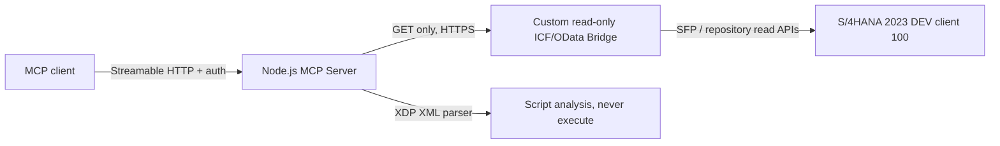

# SAP Bridge integration contract (not a standard SAP API)

This contract defines an **optional custom read-only HTTPS service** which the TypeScript MCP Server consumes. Do **not** mistake `/sap/bc/zform_read/v1/...` for SAP standard ADT or OData endpoints. The server has **not** connected to any SAP system.

## Recommended architecture



The custom SAP service should expose only the following GET calls, with `sap-client=100` and credentials supplied by the MCP server as HTTP headers:

| Method / URL | Example JSON response | SAP implementation note |
|---|---|---|
| `GET /forms?pattern=Z*&limit=50` | Array of `FormSummary` | Query own repository objects; custom forms only |
| `GET /metadata?name=ZDEMO_INVOICE` | `FormMetadata` object | Form title, package, language, interface, activation and change data |
| `GET /interface?name=ZDEMO_INVOICE` | `FormInterface` object | Obtain actual SFP form interface, including parameter directions and data types |
| `GET /context?name=ZDEMO_INVOICE` | `FormContext` object | Obtain actual SFP context hierarchy/bindings; do not substitute XDP layout hierarchy |
| `GET /layout?name=ZDEMO_INVOICE` | `{ "formName": "ZDEMO_INVOICE", "xdpBase64": "..." }` | Return **actual SFP XDP layout bytes** encoded as base64, size limited |

The prefix is configured as `apiPath` in `config/destinations.json`. The full request is `https://host:port` + `apiPath` + route + `?sap-client=...`.

## JSON schemas

### `/forms`

```json
[
  {
    "name": "ZDEMO_INVOICE",
    "description": "Sample invoice",
    "package": "ZDEMO_FORMS",
    "interfaceName": "ZIF_DEMO_INVOICE",
    "active": true
  }
]
```

### `/metadata`

```json
{
  "name": "ZDEMO_INVOICE",
  "description": "Sample invoice",
  "package": "ZDEMO_FORMS",
  "interfaceName": "ZIF_DEMO_INVOICE",
  "active": true,
  "originalLanguage": "EN",
  "lastChangedAt": null,
  "technology": "SFP_CLASSIC"
}
```

### `/interface`

```json
{
  "formName": "ZDEMO_INVOICE",
  "interfaceName": "ZIF_DEMO_INVOICE",
  "interfaceType": "ABAP_DDIC",
  "parameters": [
    { "name": "IS_HEADER", "direction": "IMPORTING", "type": "ZSTR_DEMO_HEADER" },
    { "name": "IT_ITEMS", "direction": "IMPORTING", "type": "ZTT_DEMO_ITEM" }
  ]
}
```

### `/context`

```json
{
  "formName": "ZDEMO_INVOICE",
  "nodes": [
    {
      "name": "HEADER",
      "kind": "STRUCTURE",
      "children": [{ "name": "INVOICE_NO", "kind": "FIELD", "binding": "IS_HEADER-INVOICE_NO" }]
    }
  ]
}
```

### `/layout`

```json
{ "formName": "ZDEMO_INVOICE", "xdpBase64": "PD94bWwgdmVyc2lvbj0iMS4wIj8+..." }
```

The base64 above is a truncated illustration, NOT working form data.

## SAP implementation planning (needs verification in target system)

1. Create an independently authorization-checked ICF endpoint or OData service in DEV, only permitting GET. Return HTTP `405` for other methods and `403` on failed authorization.
2. Do not expose standard ADT or administrative endpoints through this bridge. For the repository list, SAP records SFP Form objects in `TADIR` with `R3TR SFPF`; interface objects are `R3TR SFPI` (SAP Help Portal). A preliminary SQL approach for **list only** is shown below. Verify additional name filters, language and authorization in DEV.
3. Discover supported, read-only SFP repository classes/function modules via ADT/SE24/SE37 in your **specific** S/4HANA 2023 FPS01 release. Do not assume APIs available for ABAP Cloud or BTP form reader work for traditional SFP objects.
4. Map form metadata, form interface and form context from these APIs. These are different SFP concepts, not automatically derivable by parsing the layout.
5. Only after the actual XDP is obtained and exported correctly, wire up `/layout`. Compare its contents with the SFP Layout download for one known Z form; test empty and large layouts.
6. Test in DEV with a dedicated user permitted only to read authorized forms; prohibit any update, activation, transport, or generation in the implementation.

### ABAP SQL starting point (repository listing only)

```abap
"Illustration to include in an authorized ABAP read service, not a complete service implementation.
DATA(lv_sql_pattern) = replace( val = iv_pattern sub = '*' with = '%' occ = 0 ).
SELECT obj_name, devclass
  FROM tadir
  WHERE pgmid    = 'R3TR'
    AND object   = 'SFPF'
    AND obj_name LIKE @lv_sql_pattern
  ORDER BY obj_name
  INTO TABLE @DATA(lt_sfp_objects)
  UP TO @iv_limit ROWS.
```

`TADIR` contains repository directory information, not the full SFP interface/context/layout. Enforce custom Z/Y or explicitly permitted customer namespaces rather than returning every object. Above is indicative ABAP syntax requiring local activation review; adjust `iv_pattern` input validation and namespaced form handling.

## HTTPS and security

- SAP credential variables are environment variables; never put passwords or access tokens in `destinations.json` or MCP tool arguments.
- Verify SAP TLS certificates; for private CA use `NODE_EXTRA_CA_CERTS`, not `NODE_TLS_REJECT_UNAUTHORIZED=0`.
- Network access should allow Node server -> SAP DEV only; avoid exposing the SAP ICF endpoint publicly.
- Maximum read and XDP sizes are checked in Node; also enforce them on SAP server.
- Add SFP read authorizations and a custom bridge authorization check. Gateway technical-user roles must be reviewed by SAP security.
- Forms could contain confidential business logic: audit caller identity and form names, but avoid logging raw XDP content.

## References

- SAP repository transport types SFPI / SFPF: https://help.sap.com/docs/SAP_NETWEAVER_AS_ABAP_FOR_SOH_740/e0e3d14ea0214efc82251725ba84c4a1/4aa193ecacd5007fe10000000a42189c.html
- SFP Form Builder interface/context: https://help.sap.com/saphelp_autoid2007/helpdata/EN/6e/db0cee629b4f43a4f93f59e979aa8a/content.htm
- SFP form context: https://help.sap.com/saphelp_autoid2007/helpdata/en/2a/a13f6f8c2247cea4c15e7094108710/content.htm
- SAP CL_FP_FORM_READER documentation pertains to stored form templates; **do not substitute it as a verified classic SFP extraction API**: https://help.sap.com/docs/btp/sap-business-technology-platform/retrieve-stored-form-templates
