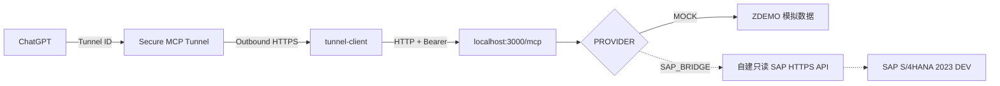

# 从 0 配置 SAP Adobe Form MCP Server（Windows + ChatGPT）

> 适用：Windows 11 / PowerShell、Node.js 22+、TypeScript、MCP SDK v2、Streamable HTTP、OpenAI Secure MCP Tunnel。  
> 目标：**先用 MOCK 模式打通 ChatGPT 工具调用**，再实施 SAP S/4HANA 2023 DEV 的真实只读读取。  
> 记录日期：2026-11-17。所有敏感值均使用占位符，不要把 API Key、SAP 密码或 Token 发到聊天中。

## 0. 完成后的拓扑与验收标准



**验收分层**：
1. 项目层：`npm run check`、`npm run build`、`npm test` 全部成功。
2. 本地 MCP 层：`npm run smoke` 实际执行 `initialize`、`tools/list`、`list_custom_forms`。
3. Tunnel 层：`/health/control-plane` 显示 `ok`，并在真实工具调用后观察响应交付；单看 `/readyz=ready` 不够。
4. ChatGPT 层：插件发现 6 个 Tools，调用其中一个工具返回 MOCK 内容。
5. SAP 层（后续）：经授权实现自定义 Bridge、切换 Provider、核对真实 SFP 表单；**本次尚未完成**。

## 1. 安装基础环境

**1.1 安装 Node.js LTS**：从 [Node.js 官网](https://nodejs.org/) 获取受支持的 LTS（项目要求 `>=22`），安装时允许加入 PATH。打开新的 PowerShell：

```powershell
node --version
npm --version
Get-Command node
```

**1.2 准备编辑器**：安装 VS Code（可选 TypeScript/ESLint 扩展），确保本机可访问 npm 注册表。

**1.3 准备源代码**：解压配套 `SAP_Adobe_Form_MCP_Updated.zip`，进入其中的 `sap-adobe-form-mcp` 目录。例如：

```powershell
cd "C:\Users\TAO JING\Desktop\sap-adobe-form-mcp-starter\sap-adobe-form-mcp"
Get-ChildItem package.json, tsconfig.json, .env.example
```

如果完全从空目录建立 Node 项目，可先执行 `npm init -y`、`npm install` 所需依赖，然后放入本项目中的 `src/`、`config/`、`scripts/`、`tests/`、`package.json` 与 `tsconfig.json`。**只执行 `npm init` 不会自动生成 MCP 代码**；本教程以配套可运行的源码为基础，避免抄写多份过时代码。

## 2. 初始化项目与 `.env`

安装依赖：

```powershell
npm install
Copy-Item .env.example .env
notepad .env
```

在 `.env` 中至少检查：

```dotenv
PROVIDER=MOCK
HOST=127.0.0.1
PORT=3000
MCP_AUTH_TOKEN=REPLACE_WITH_YOUR_OWN_RANDOM_TOKEN
DEFAULT_DESTINATION=DEV100
DESTINATIONS_FILE=config/destinations.json
```

**安全生成本地 Token**（兼容 Windows PowerShell 5.1）：

```powershell
$bytes = New-Object byte[] 32
$rng = [System.Security.Cryptography.RandomNumberGenerator]::Create()
try {
    $rng.GetBytes($bytes)
    $token = [BitConverter]::ToString($bytes).Replace("-", "").ToLowerInvariant()
    $token
} finally {
    $rng.Dispose()
}
```

复制实际生成的 Token 到 `.env` 的 `MCP_AUTH_TOKEN`。示例中的占位符不能直接使用。不要提交 `.env`，不要截图暴露 Token。**它不是 OpenAI API Key，也不是 SAP 用户密码。**

## 3. 编译、测试、启动

在项目目录执行：

```powershell
npm run check
npm run build
npm test
npm start
```

期望服务日志类似：

```text
[sap-adobe-form-mcp] http://127.0.0.1:3000/mcp (mode=MOCK, read-only)
```

保持这个终端运行。打开第二个 PowerShell，仍在项目目录下：

```powershell
npm run smoke
```

`smoke` 会使用 `.env` 中的 Token 调用实际 MCP 流程并输出发现的工具及 `list_custom_forms` 结果。还可以查看无认证的健康端点：

```powershell
curl.exe http://127.0.0.1:3000/health
```

**注意**：直接在浏览器地址栏打开 `http://127.0.0.1:3000/mcp` 返回：

```json
{"error":"Unauthorized"}
```

这是因为该路由强制检查 `Authorization: Bearer <MCP_AUTH_TOKEN>`；不能用浏览器地址栏 GET 判断 MCP Server 损坏。

**项目 Tools**：

| Tool | 用途 | 当前模式 |
|---|---|---|
| `list_custom_forms` | 查询自开发表单列表 | MOCK |
| `get_form_metadata` | 元数据、包、接口名 | MOCK |
| `get_form_interface` | 导入导出参数/数据类型 | MOCK |
| `get_form_context` | SFP Context 节点与绑定 | MOCK |
| `get_form_layout` | XDP 内容读取与 XML 验证 | MOCK；真实 XDP 待 SAP 验证 |
| `analyze_form_scripts` | FormCalc/JS 生命周期静态分析 | MOCK；非代码执行 |

### 常见编译问题：TS2375

如果原始版本的 `src/types.ts` 报 `ZodLazy ... not assignable to ZodType<ContextNode>`，检查 `ContextNode` 的这两项：

```typescript
binding?: string | undefined;
children?: ContextNode[] | undefined;
```

这是 `exactOptionalPropertyTypes: true` 与 Zod `.optional()` 推断类型之间的差异；**不建议通过关闭严格校验来掩盖**。本次更新打包的源码已同步该修正。

### npm 警告是否要升级？

`npm notice New major version ...` 只是通知，既然 `build` 和测试通过，就不必为此升级。`npm fund` 同样不是错误。若出现 `esbuild` 的 install-scripts 提醒，先看编译是否受影响；有需要再按已安装 npm 版本的提示审核并批准可信安装脚本。

## 4. 安装并设置 Windows tunnel-client

对于当前 Windows x64 环境，已有可执行文件：

```text
E:\tunnel-client-v0.0.20-windows-amd64\tunnel-client.exe
```

其他机器可从 [openai/tunnel-client Releases](https://github.com/openai/tunnel-client/releases) 选择匹配系统架构的版本。项目路径中**不要**把完整 `.exe` 路径加进 PATH，应该添加它所在的**目录**：

```powershell
$toolDir = "E:\tunnel-client-v0.0.20-windows-amd64"
if (-not (Test-Path (Join-Path $toolDir "tunnel-client.exe"))) {
    throw "tunnel-client.exe not found"
}
$userPath = [Environment]::GetEnvironmentVariable("Path", "User")
if (($userPath -split ";") -notcontains $toolDir) {
    $newPath = if ([string]::IsNullOrWhiteSpace($userPath)) {
        $toolDir
    } else {
        "$($userPath.TrimEnd(';'));$toolDir"
    }
    [Environment]::SetEnvironmentVariable("Path", $newPath, "User")
}
$env:Path = [Environment]::GetEnvironmentVariable("Path","Machine") + ";" +
            [Environment]::GetEnvironmentVariable("Path","User")
Get-Command tunnel-client
tunnel-client --help
```

此操作保存的是**当前 Windows 用户级 PATH**，无需系统管理员权限。新 PowerShell / VS Code 终端需要重开才能继承变更。

## 5. 创建 OpenAI Secure MCP Tunnel

1. 在 [Platform Tunnels](https://platform.openai.com/settings/organization/tunnels) 创建 Tunnel，记录系统返回的**完整** `tunnel_...` ID；关联正确组织/工作区（如控制台要求）。
2. 在 [Platform Runtime API Keys](https://platform.openai.com/settings/organization/api-keys) 创建 **Restricted** Runtime Key，使用 **Tunnels Read + Use** 的最小权限；必要时由有权限的管理员授权。
3. 不要把 [Admin API Key](https://platform.openai.com/settings/organization/admin-keys) 当作常驻 Tunnel Runtime Key；Admin Key 仅用于 Tunnel 管理操作。
4. 确认 ChatGPT 工作区允许创建自定义 MCP 插件。当前官方文档：Business 由 Admin/Owner 创建；Enterprise/Edu 可通过 RBAC 给授权成员开放创建权限。

**三个凭据要区分**：

| 名称 | 由谁提供 | 用途 |
|---|---|---|
| `MCP_AUTH_TOKEN` | 本机自行随机生成 | 本地 MCP Server 校验 |
| `CONTROL_PLANE_TUNNEL_ID` | Platform Tunnels | Tunnel 的唯一标识 |
| `CONTROL_PLANE_API_KEY` | Platform Runtime API Keys | Tunnel Client 向 OpenAI 控制平面认证 |

## 6. 配置 Tunnel Client：目标地址与本地 Bearer

**保持第 3 步的 `npm start` 窗口运行**，另开一个专门运行 Tunnel 的 PowerShell：

```powershell
$env:CONTROL_PLANE_TUNNEL_ID = "tunnel_替换成平台返回的完整ID"
$env:MCP_SERVER_URL = "http://127.0.0.1:3000/mcp"
```

为了避免 Runtime API Key 直接出现在命令历史中，使用安全输入：

```powershell
$secure = Read-Host "Tunnel Runtime API Key" -AsSecureString
$ptr = [Runtime.InteropServices.Marshal]::SecureStringToBSTR($secure)
try {
    $env:CONTROL_PLANE_API_KEY = [Runtime.InteropServices.Marshal]::PtrToStringBSTR($ptr)
} finally {
    [Runtime.InteropServices.Marshal]::ZeroFreeBSTR($ptr)
}
Remove-Variable secure,ptr
```

**将本地 MCP Token 作为 Tunnel 内部 Header 注入**。以下 `$projectDir` 请与实际位置保持一致：

```powershell
$projectDir = "C:\Users\TAO JING\Desktop\sap-adobe-form-mcp-starter\sap-adobe-form-mcp"
$line = Get-Content (Join-Path $projectDir ".env") |
    Where-Object { $_ -match '^\s*MCP_AUTH_TOKEN\s*=' } |
    Select-Object -First 1

if (-not $line) { throw "MCP_AUTH_TOKEN is missing" }
$token = ($line -replace '^\s*MCP_AUTH_TOKEN\s*=\s*', '').Trim().Trim('"').Trim("'")
if ($token.Length -lt 24) { throw "MCP_AUTH_TOKEN is too short" }

$env:MCP_LOCAL_BEARER = "Bearer $token"
$env:MCP_EXTRA_HEADERS = "Authorization: env:MCP_LOCAL_BEARER"
Remove-Variable token
```

这里的 `env:MCP_LOCAL_BEARER` 是 Tunnel Client 的**环境变量引用语法**，不是让你把字面量当作令牌发送。它会为 Tunnel → 本地 MCP Server 的请求添加 `Authorization` 头。不要打印 `$env:MCP_LOCAL_BEARER`，也不要保存敏感值到 Windows 全局环境变量或 Git。

> **认证边界**：ChatGPT 侧按当时已配置的 Tunnel 连接选择“无需身份验证”；Tunnel Client 在本地加 Header。该方案仅适用于本机开发测试；企业生产部署应使用组织认可的认证/授权、安全审查和最小权限策略。

## 7. 如果需要 VPN / 本地 HTTP 代理

此前控制平面出现过 `poll transport failed (network_error)`。**只有本机代理实际存在时**才配置，例如本地代理端口 `7897`（根据自己的网络客户端调整）：

```powershell
Test-NetConnection 127.0.0.1 -Port 7897
curl.exe -I --max-time 15 --proxy http://127.0.0.1:7897 https://api.openai.com/v1/models
```

`401 Unauthorized` 的 API 响应常表示 HTTPS 已经到达 API（缺少 API Bearer 凭据）；连接超时/拒绝则需要先修复网络。

同一个 Tunnel PowerShell 窗口：

```powershell
$env:CONTROL_PLANE_HTTP_PROXY = "http://127.0.0.1:7897"
$env:HARPOON_HTTP_PROXY = "http://127.0.0.1:7897"
$env:NO_PROXY = "127.0.0.1,localhost"
```

不要将本地 `127.0.0.1:3000` MCP 流量错误地送往外部代理。**代理地址只是本次网络的示例值，不是所有机器的默认端口。**

## 8. 启动 Tunnel 并判断诊断信息

在**已设置上述环境变量的同一个窗口**运行：

```powershell
tunnel-client help quickstart
tunnel-client doctor --explain
tunnel-client run
```

再打开第三个 PowerShell 查询：

```powershell
curl.exe http://127.0.0.1:8080/healthz
curl.exe http://127.0.0.1:8080/readyz
curl.exe http://127.0.0.1:8080/health/mcp
curl.exe http://127.0.0.1:8080/health/control-plane
curl.exe http://127.0.0.1:8080/health/response-delivery
```

端口 `8080` 是本次使用的默认本地健康接口端口；如果启动时配置了不同监听地址，请以实际日志为准。

| 返回 | 正确解读 |
|---|---|
| `/healthz` → `live` | Tunnel 进程存活 |
| `/readyz` → `ready` | 就绪端点响应；**不是**工具发现成功的证明 |
| `control-plane.status=ok`、`polling` | 控制平面连接正常 |
| `mcp.status=unknown` + `unsupported_transport` | 该诊断证据不可用；**不能**直接断言 MCP 初始化成功/失败 |
| `response-delivery.attempts=0` | 尚未观察到经过 Tunnel 的响应交付尝试 |
| `mcp initialize ... Unauthorized` | Tunnel 向本地 MCP 发起的探测未带有效 Token；检查 `MCP_EXTRA_HEADERS`、同一 PowerShell 会话及服务 `.env` |

可以打开 `http://127.0.0.1:8080/ui` 查看 Tunnel Client 本地管理界面（如当前版本提供）。

## 9. 在 ChatGPT 注册 MCP 插件并实际调用

依照 [OpenAI 官方操作说明](https://help.openai.com/en/articles/12584461-connecting-custom-mcp-servers-in-chatgpt)：

1. 在 ChatGPT Web 进入 **Plugins**，点 `+` → **Add custom MCP server**。
2. 名称：`SAP Adobe Form MCP`；描述：`Read-only SAP Adobe Form analysis`。
3. Connection 选择 **Tunnel**，选已有 Tunnel 或填 `tunnel_...`；**不要**填本地 `127.0.0.1:3000` 到 ChatGPT 的公网 URL 栏。
4. 对此本地 Token + Tunnel Header 方案，ChatGPT 端按设计使用“无需身份验证”；勾选风险确认。
5. 选择 **Create as a plugin**，检查实际发现工具列表，然后安装插件。
6. 新开聊天，用 `@` 选择插件，发送：

```text
请实际调用 SAP Adobe Form MCP 的 list_custom_forms，
列出 MOCK 模式下的 Z* 表单。请返回工具的原始结果，
不要根据描述自行编造结果。
```

**验证成功的充分证据**应包括：插件端成功发现六个工具；ChatGPT 实际调用 `list_custom_forms` 并拿到 ZDEMO 模拟结果；Tunnel 日志中能看到请求/响应。仅凭 `ready`、`polling` 或浏览器能打开 ChatGPT 不算验收完成。

> 到本会话最后一张截图为止，**尚未看到“创建插件成功”或“ChatGPT 实际调用工具成功”的证据**。这一项应保持“待验证”。

## 10. 常见问题速查

| 症状 | 主要原因 / 建议 |
|---|---|
| `npm install` 有 funding/npm upgrade 提示 | 普通通知；先运行 build/test |
| `TS2375` | Zod `.optional()` 与严格类型定义不匹配；见第 3 步 |
| 浏览器打开 `/mcp` → `Unauthorized` | 未携带本地 Bearer Token；改用 `npm run smoke` |
| `/readyz` 显示 `mcp initialize ... Unauthorized` | Tunnel 未传有效认证头；重配 `MCP_LOCAL_BEARER` / `MCP_EXTRA_HEADERS` |
| `poll transport failed (network_error)` | 检查代理、DNS、能否连接 `https://api.openai.com` |
| `/health/control-plane` 显示 `polling` | 结合 `status`、`last_success`、`consecutive_failures` 判断；只看 `polling` 不够 |
| `/health/mcp` 是 `unknown` | 在本次 Streamable HTTP 诊断条件下可能缺少证据，继续测试真实工具调用 |
| `/health/response-delivery.attempts=0` | 未观察到响应交付，不足以断言失败 |
| ChatGPT 未发现工具 | 检查 Tunnel ID、权限、MCP Token、`npm run smoke`、真实请求日志 |
| SAP 返回 404/403 | 实际 SAP 只读 Bridge 尚未建立，或服务/权限未配置；不是 TypeScript SDK 本身问题 |

## 11. 切换真实 SAP 数据（后续独立阶段）

只有以下条件都满足时才考虑切换：

- 已获准访问 DEV，且建立仅 GET 的自定义 SAP ICF/OData 读取接口；
- `/forms`、`/metadata`、`/interface`、`/context`、`/layout` 按 `docs/SAP_BRIDGE_CONTRACT.md` 实现；
- 已定义技术用户、权限和证书信任，并做过 SFP 表单名/内容的授权检查；
- 先单独验证 Layout 返回的确实是 XDP（非 PDF/HTML），再开放脚本静态分析；
- 将 `.env` 的 `PROVIDER=SAP_BRIDGE` 并配置 `SAP_DEV100_USER` / `SAP_DEV100_PASSWORD` 或受控 Token，重启后验证。

**重要**：`/sap/bc/zform_read/v1/...` 在本项目中是**建议的自定义服务路径**，不是 SAP 标准现成 API。对真实 SAP 的任何读取/连接，本次均未完成；更不能声称已获得表单 Context 或 Layout。

## 12. 后续安全建议

- 不在仓库或聊天中粘贴 `.env`、Runtime API Key、SAP 密码、完整 XDP。
- Mock 测通后先最小权限验证 SAP，保持所有 MCP Tools 只读。
- 企业接入前评估 XDP/脚本是否包含机密逻辑；为表单名、访问者、操作时间建立安全审计。
- 涉及真实 SAP 的内网访问必须遵守组织 IT / 网络与数据安全审批流程。

## 参考链接（2026-11-17 核对）

- [OpenAI — Connecting custom MCP servers in ChatGPT](https://help.openai.com/en/articles/12584461-connecting-custom-mcp-servers-in-chatgpt)
- [OpenAI — tunnel-client Releases](https://github.com/openai/tunnel-client/releases)
- [OpenAI — Tunnel configuration](https://github.com/openai/tunnel-client/blob/master/docs/configuration.md)
- [OpenAI — Tunnel onboarding](https://github.com/openai/tunnel-client/blob/master/docs/onboarding.md)
- [OpenAI — Tunnel troubleshooting](https://github.com/openai/tunnel-client/blob/master/docs/troubleshooting.md)
- [MCP TypeScript SDK v2](https://ts.sdk.modelcontextprotocol.io/v2/)
